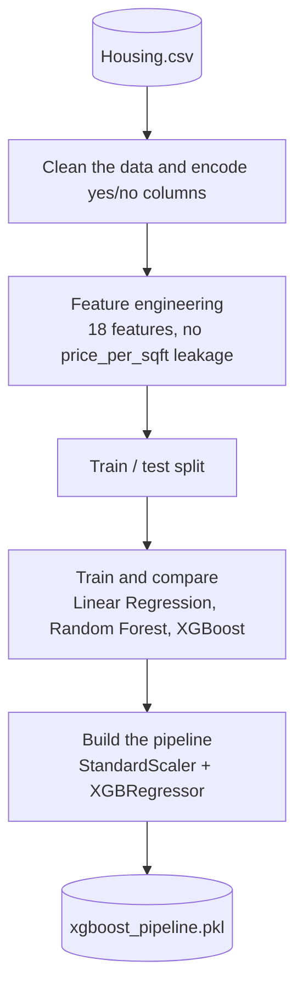
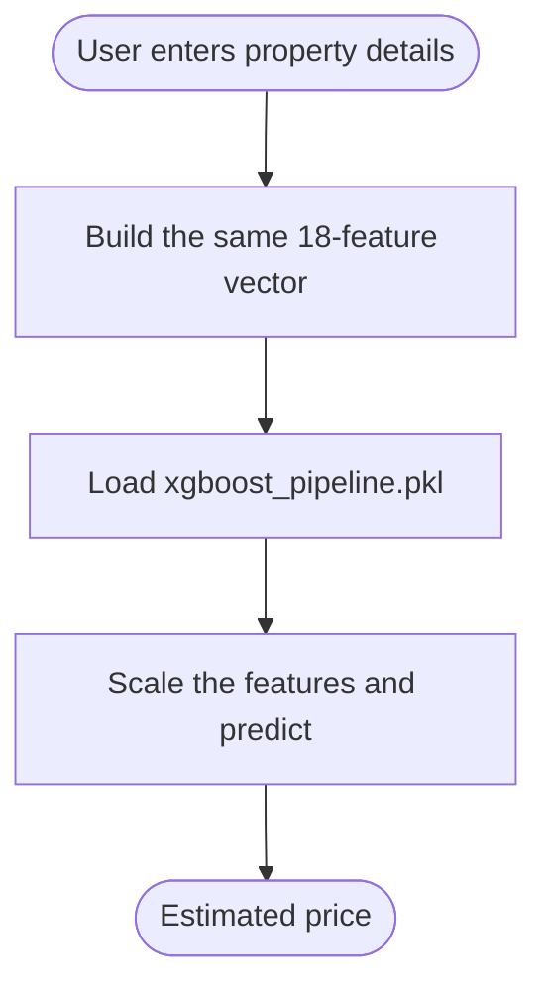

# 🚀 House Price Prediction

Estimate a property's price from its features using an XGBoost model, served through a Streamlit app.

## 📌 Overview

This project trains a regression model on a housing dataset (area, bedrooms, bathrooms, amenities, furnishing status) and exposes it through an interactive web app. Several models were compared in the notebook; the XGBoost pipeline is the one deployed.

It is useful as a quick price estimator and as a worked example of an end-to-end ML workflow.

## ✨ Features

* 18 features: raw listing fields plus engineered ones (total rooms, luxury flag, amenity score, area bucket, log-area, and more)
* Single pipeline (StandardScaler + XGBRegressor) saved and loaded as one object
* Compared Linear Regression, Random Forest, and XGBoost
* Training avoids target leakage — `price_per_sqft`, which is derived from the price, is excluded
* Streamlit app for instant predictions

## 🔄 Workflow

Training (in the notebook):



Prediction (in the Streamlit app):



## 🛠️ Tech Stack

* Language: Python
* Libraries: Pandas, NumPy, Scikit-learn, XGBoost, Matplotlib, Plotly, Streamlit
* Tools: Git, GitHub, Jupyter Notebook

## 📂 Project Structure

```
house-price-prediction/
├── Housing.csv                  # dataset
├── housepriceprediction.ipynb   # EDA, feature engineering, model comparison
├── app.py                       # Streamlit app
├── xgboost_pipeline.pkl         # trained scaler + XGBoost pipeline
├── requirements.txt
└── LICENSE
```

## ⚙️ Installation

1. Clone the repository:

```
git clone https://github.com/JAIMINRSOJITRA/house-price-prediction.git
```

2. Navigate to the project:

```
cd house-price-prediction
```

3. Install dependencies:

```
pip install -r requirements.txt
```

## ▶️ Usage

```
streamlit run app.py
```

Then open `http://localhost:8501`, enter the property details, and read the estimated price. To retrain, open `housepriceprediction.ipynb` in Jupyter and run all cells.

## 📊 Results / Demo

* The app's feature vector was checked against the trained pipeline: all 18 features match in name, order, and formula.
* See the notebook for model-comparison metrics.

## 🧠 What I Learned

* Keeping the feature engineering used at prediction time identical to training
* Spotting and removing target leakage (a feature derived from the answer)
* Bundling preprocessing and model into one pipeline to avoid mismatches

## 🔮 Future Improvements

* Show a prediction range instead of a single number
* Tune hyperparameters and report cross-validated metrics in the README
* Deploy the app (for example on Streamlit Community Cloud)

## 🤝 Contributing

Contributions, issues, and suggestions are welcome.

## 📄 License

This project is licensed under the MIT License.

## 👨‍💻 Author

Jaimin Sojitra

* GitHub: https://github.com/JAIMINRSOJITRA
* LinkedIn: https://www.linkedin.com/in/jaimin-sojitra-4683a1277/
